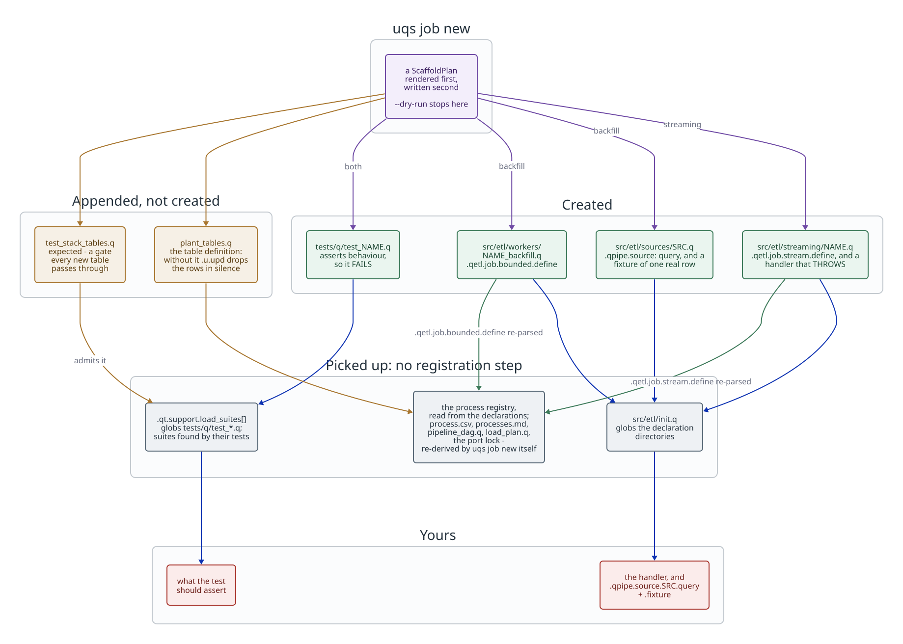

# Adding a data pipeline

This page walks one bounded pipeline end to end: scaffold it, write its source
and worker, run it, check its coverage and test it.

A pipeline is three declarations. The shell owns windowing, retries, coverage,
checkpoints, dry-run and the job graph, so you write none of that.

  | You write                          | It says                                                                  |
  | ---                                | ---                                                                      |
  | a **source** in `src/etl/sources/` | what the rows are, where they come from, how to window them              |
  | a **transform**, beside the worker | what a fetched batch becomes before it is published, with example tables |
  | a **worker** in `src/etl/workers/` | which source, which transform, which target dataset, how wide a window   |

[`src/etl/init.q`](../../src/etl/init.q) globs `sources/`, `transforms/`,
`workers/` and `streaming/`, so a declaration loads because its file exists.
Every key a declaration accepts is in [the declaration
reference](../reference/pipeline-declarations.md). Why the framework has this
shape is in [the pipeline philosophy](../architecture/pipeline-philosophy.md).

## Scaffolding it

`uqs job new` writes the skeleton: the q files, the table definition and a
failing test.

<!-- Source: docs/diagrams/scaffolding.d2. Rendered by
     `scripts/generate/derive.py diagrams`, which CI runs with --check. -->



```bash
uqs job new fx_rates --kind backfill --outputs fx_rates \
    --schema "sym:symbol, mid:float" --width 1D
```

This writes worker `fx_rates_backfill` over a new source `fx_rates`, the pair
this page fills in. `--outputs` names the dataset and `--width` the window.
`--schema` is required whenever a new source or table is written, and refused
otherwise. `--dry-run` prints what the command would write and writes nothing.
`uqs job remove NAME` undoes a scaffold. The other flags are in
`uqs job new --help`, and [`scaffolding/`](../scaffolding/README.md) has a page
for each shape, the streaming ones included.

### What a fresh scaffold leaves red

The handler throws and the test fails until you write them.
`uv run pytest python/uqs` lists, by `path:line`, every placeholder still marked
`SCAFFOLDED`: the handler, the test, the job's `note`, a new table's catalog
description, and the process's card in [Services](../services/README.md) and
comment in [`stack.md`](../architecture/stack.md). That list is the to-do list.
A line clears when you replace the placeholder and delete its marker. Name the
process in `stack.md`'s list when you delete its comment.

Write the description in
[`uqs_catalog.q`](../../scripts/processes/uqs_catalog.q) for someone deciding
whether the table is the one they want. Where a whole select of the table is not
safe to read, replace the `.qcat.unbounded` reason beside it with a
`querypolicy.csv` row. To keep the table from the desk, delete both and add the
table to `.qcat.hidden` with the reason.

## Bounded or continuous?

Choose the shell first. It is the one choice that is hard to change afterwards.

<!-- Source: docs/diagrams/pipeline-decision.d2. Rendered by
     `scripts/generate/derive.py diagrams`, which CI runs with --check. -->


- Bounded: you know the range before you start, as with a backfill, a nightly
  window or a restatement. It runs, finishes and exits. This is
  `.qetl.job.bounded`, and the rest of this page.
- Continuous: it subscribes and never finishes, as with a tickerplant feed or a
  poller. This is `.qetl.job.continuous`, whose state is a cursor.

A continuous job is one file under
[`src/etl/streaming/`](../../src/etl/streaming) with a `.qetl.job.stream.define`
call. A feed is the same with no subscription. Normalizer, bars and rolling jobs
are continuous jobs whose shell owns the lifecycle. The
[scaffolding](../scaffolding/README.md) pages and the declaration reference
cover each.

Declare every table a continuous job publishes. `.u.upd` onto a table the
tickerplant does not define discards the rows silently. A process refuses to
start when the plant lacks a table it declares.

## 1. Declare the source

Create `src/etl/sources/fx_rates.q`:

<!-- q-example: run -->
```q
/ fx_rates.q - an external reference-rate source (.qpipe.source.fx_rates).

\d .

.qpipe.source.fx_rates.source_name:`fx_rates
.qpipe.source.fx_rates.columns:`rate_time`sym`mid    / the columns this adapter reads
.qpipe.source.fx_rates.types:"psf"                    / one q type character per field
.qpipe.source.fx_rates.time_column:`rate_time         / the column the window is taken on
.qpipe.source.fx_rates.row_key:`rate_time`sym         / what identifies a row uniquely
.qpipe.source.fx_rates.tz:`UTC                        / what time_column is expressed in

.qpipe.source.fx_rates.query:{[h;range_from;range_to]
    .qetl.source.ipc[h;{[from_ts;to_ts]
        select rate_time, sym, mid from `fx_rates
            where rate_time>=from_ts, rate_time<to_ts
      };range_from;range_to]}

.qpipe.source.fx_rates.fixture:{[]
    ([] rate_time:2026.09.11D09:00:00.000000000+1D*til 5;
        sym:`EURUSD`GBPUSD`EURUSD`USDJPY`EURUSD;
        mid:1.0842 1.2631 1.0847 149.82 1.0851)}

.qetl.source.define[.qpipe.source.fx_rates.source_name;
    `source`table_name`time_column`row_key`columns`types`query`fixture`tz!
    (.qpipe.source.fx_rates.source_name;`fx_rates;.qpipe.source.fx_rates.time_column;.qpipe.source.fx_rates.row_key;.qpipe.source.fx_rates.columns;.qpipe.source.fx_rates.types;.qpipe.source.fx_rates.query;.qpipe.source.fx_rates.fixture;.qpipe.source.fx_rates.tz)];

\d .
```

- The namespace is `.qpipe.source.<source name>`, matching `source_name`. Write
  every name in full from the root.
- `columns` lists the columns you read. Leave out any the worker never touches.
- `query` is a parameterised lambda sent with `.qetl.source.ipc`, never string
  concatenation and never `h(...)`. `uqs job backfill --trace` then shows every
  query a run sends.
- The window is half-open `[from;to)`: `>=` on the lower bound and `<` on the
  upper. A wrong operator publishes every boundary row twice.
- `row_key` must be unique in the source. A source that reuses ids after a purge
  silently merges unrelated rows.
- `tz` states the zone `time_column` is expressed in. `UTC` is the only value
  that needs no zone table.
- `fixture` must be deterministic and satisfy the same contract as the live
  source. The worker uses it when no credential is configured, never when a
  connection fails.

### A source read from local HDB files

A source with ``transport:`local`` reads an HDB directory on this machine
directly, with no process serving it. `--transport local` scaffolds one. Its
credential is the directory, set in `UQF_SOURCE_CRED_<SOURCE>` or a
[`sources.csv`
row](../reference/pipeline-declarations.md#where-a-source-connects-sourcescsv).
A wrong path fails the run and never falls back to the fixture. [From one kdb+
database to another](../scaffolding/hdb-transfer.md) is the worked example.

## 2. Write the worker

Create `src/etl/workers/fx_rates_backfill.q`:

<!-- q-example: run -->
```q
/ fx_rates_backfill.q - the fx_rates bounded worker (.qpipe.job.fx_rates_backfill).

\d .

/ Refuse a batch that is shaped correctly but cannot be true.
.qpipe.job.fx_rates_backfill.quality_check:{[batch]
    if[0=count batch; :.qetl.job.bounded.no_failures[]];
    bad:select from batch where not mid>0;
    $[0=count bad;
      .qetl.job.bounded.no_failures[];
      ([] check:enlist `positive_mid;
          status:enlist `fail;
          detail:enlist "non-positive mid on ",string[count bad]," row(s)")]}

\d .

/ The transform: fetched rows in, published rows out, and an example of each.
.qetl.transform.define[`fx_rates_pips;`inputs`output`fn`examples!(
    enlist[`batch]!enlist ([] rate_time:`timestamp$(); sym:`symbol$(); mid:`float$());
    ([] rate_time:`timestamp$(); sym:`symbol$(); mid:`float$(); pip_factor:`long$());
    {[batch] update pip_factor:?[sym like "*JPY";100;10000] from batch};
    enlist `inputs`expected!(
        enlist[`batch]!enlist ([] rate_time:2026.09.11D09:00 2026.09.12D09:00; sym:`EURUSD`USDJPY; mid:1.0842 149.82);
        ([] rate_time:2026.09.11D09:00 2026.09.12D09:00; sym:`EURUSD`USDJPY; mid:1.0842 149.82; pip_factor:10000 100)))];

.qetl.job.bounded.define[`fx_rates_backfill;
    `source`outputs`width`transform`check!
    (`fx_rates;enlist `fx_rates;1D;`fx_rates_pips;.qpipe.job.fx_rates_backfill.quality_check)];
```

- The namespace is `.qpipe.job.<worker name>`. `.qetl.job.bounded.define`
  derives it from the worker name and refuses a supplied `ns` key.
- `define` writes the contract's names there, among them the methods `init`,
  `plan`, `fetch`, `publish`, `checkpoint`, `spec`, `run` and `cleanup`.
- To override a method, define it above the `define` call, which fills only the
  names the namespace lacks. An override can call the default by its full name,
  as in ``.qetl.job.bounded.publish[`fx_rates_backfill;batch]``.
- `transform` is required and runs between fetch and the check. Its one input
  must be the source's `columns` and `types` exactly. A job that publishes what
  it fetched declares `.qetl.transform.passthrough`.
- Write the transform's expected table by hand. The q suite runs every example,
  twice, and feeds each transform an empty batch.
- `check` is optional and runs between the transform and publish. It returns a
  table of failures with `check`, `status` and `detail` columns. When the batch
  passes, it returns the empty one, `.qetl.job.bounded.no_failures[]`.
- A batch that fails the check is not published and its window is not recorded
  as covered, so the next run plans it again. Check for conditions no correct
  row could meet, such as a non-positive rate or a null key.
- `io` and `facts` are optional: an [IO
  manager](../../src/etl/core/io_manager.q) to write somewhere other than the
  default, and a function from the transformed batch to a dictionary of labels
  recorded as materialisation metadata.

Without `io`, a run under `uqs job backfill` writes each row into the HDB
partition of its own date, never through the tickerplant. In plain q it writes
an in-memory table. See [the FAQ](../faq.md#where-do-a-backfills-rows-end-up).

## 3. Register it

There is nothing to register. A declaration file loads once it exists, and the
runner finds a test suite by the `test_*` functions it holds.

Sources load before workers, and files within a directory load alphabetically.
So a job must not read another job's table at load time. Take a schema from
`.qetl.plant`, which loads first.

The job graph adopts the worker from its own declaration:

<!-- q-example: transcript -->
```q
q).qetl.dag.adopt_workers[];
q).qetl.dag.def `fx_rates_backfill
kind   | `bounded
inputs | ,`fx_rates@fx_rates
outputs| ,`fx_rates
```

The uqs process registry is read from the same declarations. A worker's
`procname` defaults to `<worker>1`, and an optional `note` says why it exists. A
backfill registers with discovery, runs its range and exits, so it never starts
with the stack.

A worker's `outputs` holds exactly one dataset, the one its coverage is recorded
under. A streaming job's holds the tables it publishes, none or many. See
[Outputs](../reference/pipeline-declarations.md#outputs-----one-key-two-meanings).

## 4. Run it

In a q session from the repository root:

```q
\l src/init.q
\l scripts/processes/torq_pipeline.q
\l src/etl/init.q
```

Do not skip `scripts/processes/torq_pipeline.q`: it defines `.qtorq`, which
supplies the status and lock directories. There is no credential yet, so ask for
the fixture, then run the worker:

<!-- q-example: transcript -->
```q
q)setenv[`UQF_FIXTURE_WRITES;enlist "1"];
q).qpipe.job.fx_rates_backfill.init[`source_version`range_from`range_to!(`v1;2026.09.11D00:00;2026.09.16D00:00)];
q).qpipe.job.fx_rates_backfill.run[]
state            | `completed
windows_completed| 5
windows_failed   | 0
rows_published   | 5
cursor           | 2026.09.16D00:00:00.000000000
reactions_owed   | 0
```

To run it as a process, which is what an orchestrator starts:

```bash
uqs job backfill fx_rates_backfill --source-version v1 --from 2026-09-11 --to 2026-09-16 --fixture
```

The worker and its range are required. The source version is required too,
unless the worker declares a default `source_version`. [The backfill
page](../scaffolding/backfill.md#running-it) covers the rest of the command.

Both runs ask for the fixture, with `UQF_FIXTURE_WRITES` and `--fixture`. A run
with no credential that would write the fixture is refused otherwise. Its
coverage is recorded under `v1~fixture`, never `v1`, so a live run still fetches
the range once the credential is set.

Every run is recorded in the run ledger, with the facts each window reported.
`uqs job runs` reads it back, and no stack needs to be up:

```bash
uqs job runs list --unfinished                     # runs that began and never finished - interrupted ones
uqs job runs list                       # every run, newest first: its range, window width and counts
uqs job runs show RUN_ID                # one run, and what it recorded about each window
uqs job runs audit fx_rates --from 2026-09-11 --to 2026-09-12
                                   # one window's facts from every run that published it
```

`audit` reads `$UQF_STATUS_DIR`, or `$TORQDATA/status` when that is unset. If a
backfill stops with `etl_runs predates the run's range and counts`, run
`uqs job runs upgrade` once.

## 5. Check what it claims

A completion event is recorded for every completed window, including an empty
one. That is how "ran and found nothing" differs from "never ran".

<!-- q-example: transcript -->
```q
q).qetl.coverage.is_covered[`fx_rates;`;`$"v1~fixture";.z.p;2026.09.11D00:00;2026.09.16D00:00]
1b
q).qetl.coverage.is_covered[`fx_rates;`;`v1;.z.p;2026.09.11D00:00;2026.09.16D00:00]
0b
```

The version is `` `$"v1~fixture" `` because step 4 wrote the fixture. A live
run's coverage is under `v1`. The `` ` `` is the partition, and every read
requires it. It means the dataset has no partition dimension. See
[below](#filling-one-dataset-with-several-workers).

Run the worker a second time and it is `idle`, which is a success:

<!-- q-example: transcript -->
```q
q).qpipe.job.fx_rates_backfill.run[][`state]
`idle
```

`.qetl.coverage.missing` narrows a range to what is still absent,
`.qetl.coverage.history` shows every claim ever made, and
`.qetl.coverage.contributing_runs` says which executions built it.

## 6. Test it

Add `tests/q/test_fx_rates_backfill.q`. Define its tests under
`.qt.qpipe.job.fx_rates_backfill` from the root, with the whole path and no
`\d`, as the scaffold writes it. Then:

```bash
uv run pytest tests/qrun/test_q_suite.py::test_the_q_suite_passes
```

Cover more than the happy path: a second run is idle, a version bump re-runs the
whole range, a partial run is narrowed to the gap, a middle gap is not bridged
by a window spanning it, a contract-breaking source records no coverage, a dry
run publishes nothing, and each contract method delegates.
`uv run pytest -m coverage tests/qrun/test_q_coverage.py` shows which of those
you missed.

None of that sends your `query`: the unit suite sets no credential, so the
worker runs on its fixture. To run it against a real second process, follow
[`tests/q/run_two_instances.q`](../../tests/q/run_two_instances.q). Start a
plain q process holding the upstream table, set
`UQF_SOURCE_CRED_<SOURCE>=host:port`, and run the worker.

In the query, write `` from `trade ``, never `from trade`. The lambda carries
its `.qpipe.source.fx_rates` context across the wire, so a bare name resolves in
that namespace on the remote and throws.

## Recomputing on an upstream publish

A published window announces itself. Register a reaction and it runs, with the
range that was just published, as soon as the window is recorded. [The reaction
page](../scaffolding/reaction.md) scaffolds one.

<!-- q-example: run -->
```q
`positions set ([sym:`symbol$(); window:`timestamp$()] notional:`float$());

.qetl.reaction.on[`demo_deals;`rebuild_positions;{[ds;range_from;range_to]
    / recompute exactly what changed - the range is handed to you
    `positions upsert select sum notional by sym, window:range_from from
        select from demo_deals where deal_time within (range_from;range_to-1)
    }];
```

Run against the five-day demo range, that fills itself as each window publishes:

```text
run:  `state`windows_completed`rows_published!(`completed;5;5)

sym    window                       | notional
------------------------------------| --------
EURUSD 2026.09.11D00:00:00.000000000| 1000000
GBPUSD 2026.09.12D00:00:00.000000000| 2500000
EURUSD 2026.09.13D00:00:00.000000000| 750000
USDJPY 2026.09.14D00:00:00.000000000| 3000000
EURUSD 2026.09.15D00:00:00.000000000| 1250000
```

Key the derived rows by the window as well as `sym`. The handler is called once
per window, so a row keyed on `sym` alone is overwritten by the next window.
Keyed by the window, the total is `select sum notional by sym from positions`,
and re-publishing a window replaces its own row.

- A handler runs at least once per window, so make it idempotent.
  `.qetl.reaction.write` replaces a window instead of appending to it.
- A failing reaction leaves the rows and the coverage in place, but the run ends
  `partial` while a reaction over its range is owed. `uqs job backfill --wait`
  prints the error and exits 1.
- The next real run of the worker over that range fetches an owed window again
  and re-announces it. Every reaction for the dataset runs again, on the
  source's rows as they are now. Pin the release with `source_version` if that
  matters. A reaction added after its dataset was published is filled the same
  way.
- A handler may publish. The same `(dataset, range)` is dispatched at most once
  per drain, and `.qetl.reaction.max_depth` bounds a chain of new ranges.
- Failures land in `.qetl.reaction.history`, the `etl_reactions` ledger and the
  log.

### Reactions in the job graph

`.qetl.dag.adopt_all[]` picks up reactions alongside workers, feeders and the
streaming processes. How you [register
one](../reference/pipeline-declarations.md#reactions-----qetlreaction) decides
its output in the graph:

- `.qetl.reaction.on_worker` derives it from the worker's own declaration.
  Prefer it where it applies. It is plain q only: a TorQ process refuses it.
- `.qetl.reaction.on_writing` records the output you assert, for a handler that
  writes something no worker owns.
- `.qetl.reaction.on` declares none, so the reaction is a terminal node.

A reactive cycle is refused when you wire it. A reaction node is named
`<dataset>~<reaction>`. Build that name with
`.qetl.dag.reaction_job[dataset;name]`, because `~` cannot appear in a q symbol
literal. `.qetl.reaction.audit[]` lists graph edges with no reaction behind
them, and reactions on datasets the graph does not know.

A reaction recomputes because data arrived. To recompute because time passed,
use `.qtorq.safe_timer`.

## Filling one dataset with several workers

One worker fills each `(dataset, partition)` pair. Declare a `partition`, and
the `partition_column` of the output that holds it, and two workers can fill one
dataset at once:

<!-- q-example: run -->
```q
.qetl.job.bounded.define[`fx_rates_eurusd;
    `source`outputs`width`transform`partition`partition_column!(`fx_rates;enlist `fx_rates;1D;`fx_rates_pips;`EURUSD;`sym)];
```

`define` refuses a `partition` without its column, and a second worker on the
same dataset and partition. Publish refuses another partition's rows, and a
`replace` clears only this partition's.

Coverage is recorded and read under that partition, and no read unions across
partitions. A range covered for `` `EURUSD `` says nothing about `` `USDJPY ``.
A worker that declares no partition gets the `` ` `` sentinel.
