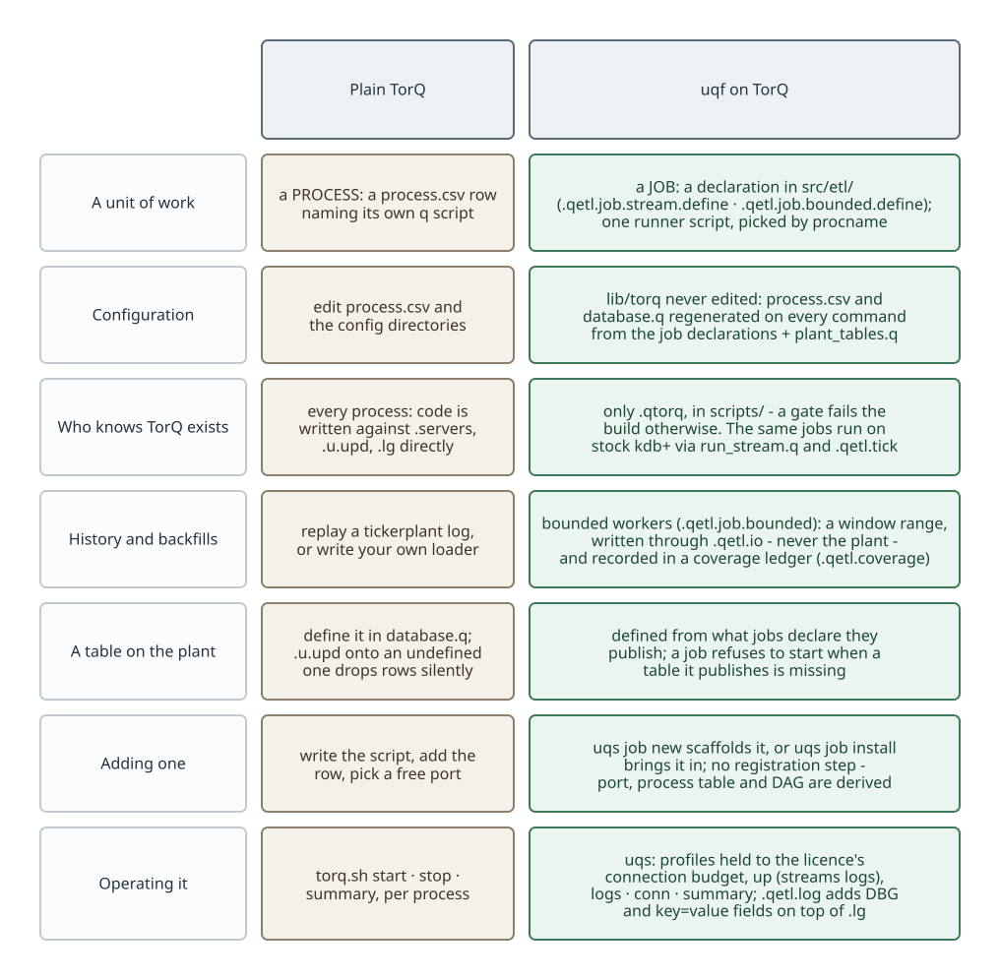
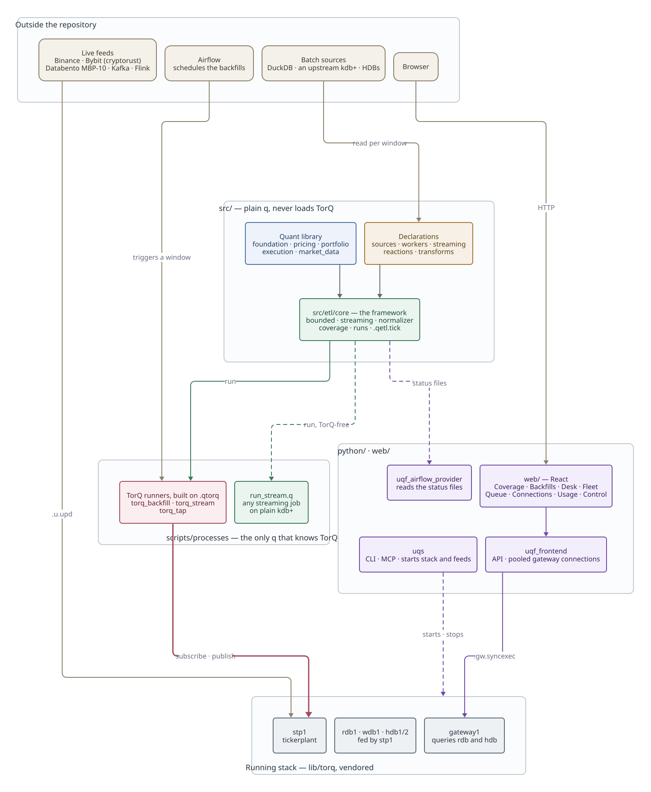
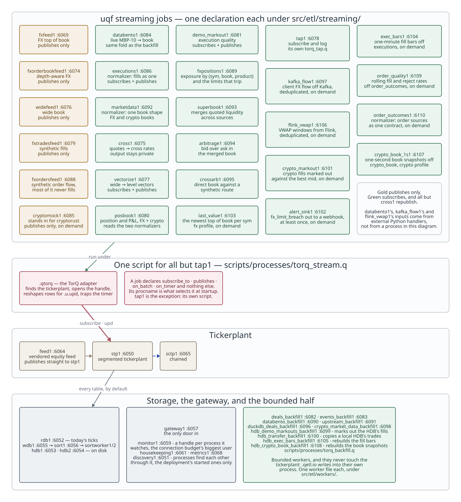
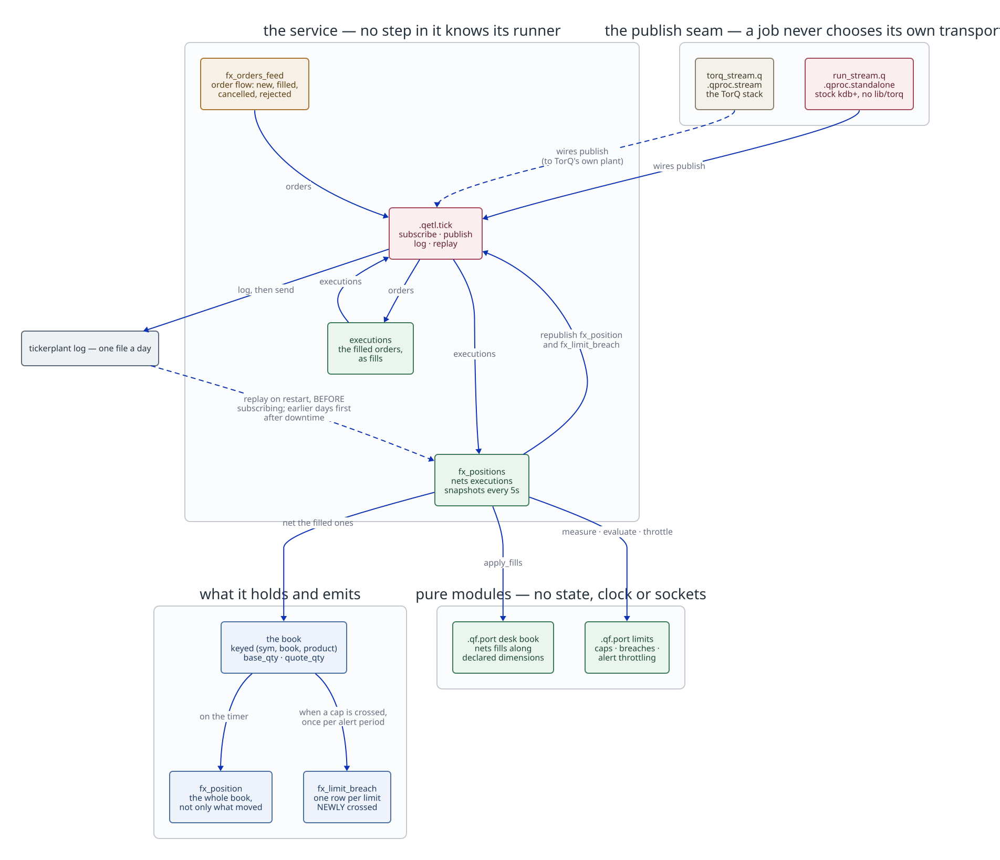
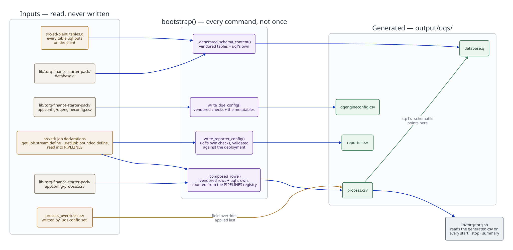
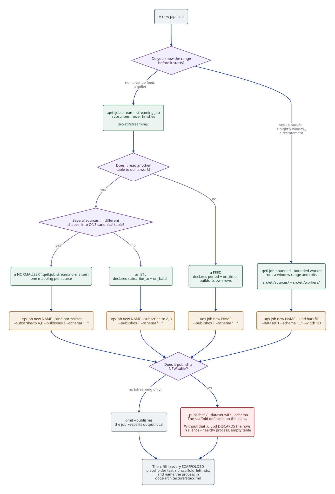
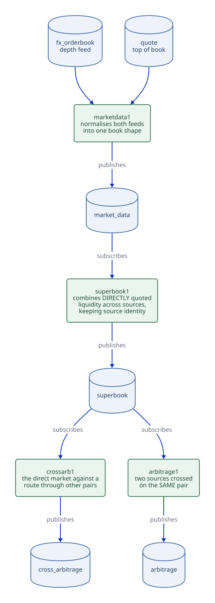
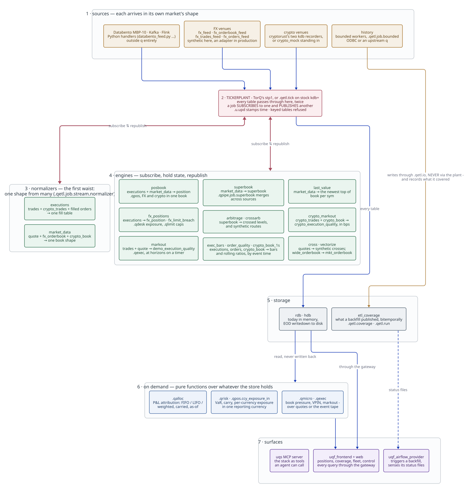
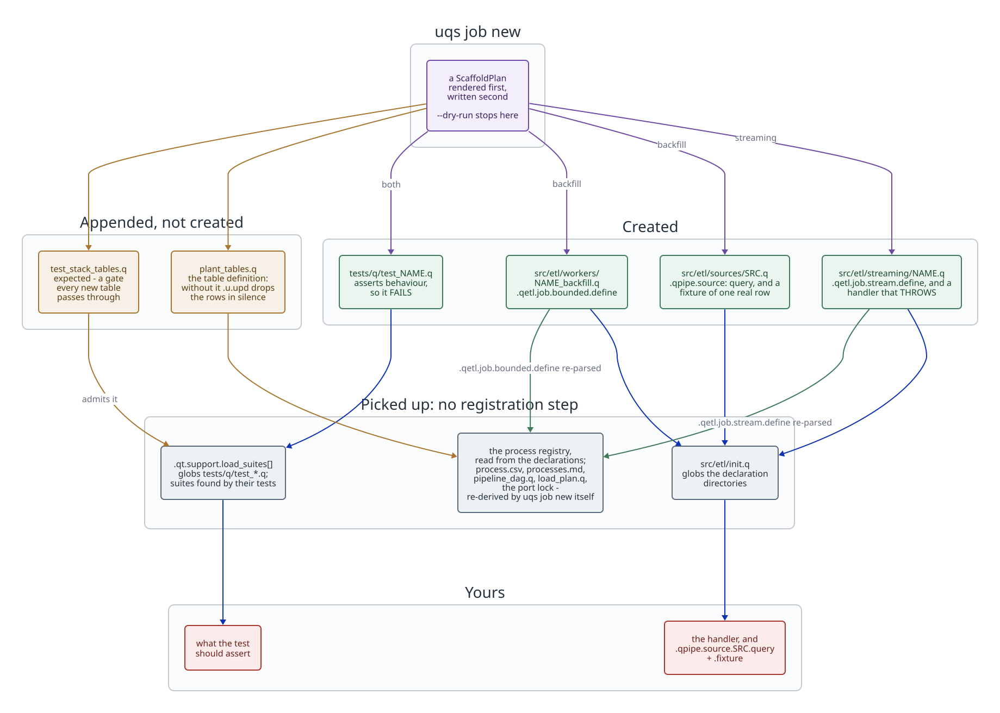

## TorQ stays. What changes is around it. {.smaller}

::: {.columns}
::::: {.column width="55%"}
{height="740"}
:::::
::::: {.column width="45%"}
- stp1, the RDB, WDB and HDB, discovery and the gateway are **TorQ's,
  unmodified**.
- `lib/torq` and the starter pack are vendored and **never edited**.
- uqf changes three things:
  - what you write: a **job declaration**, not a process;
  - who knows TorQ exists: **one namespace**, `.qtorq`;
  - how you run it: **`uqs`**, in place of editing process.csv and calling
    torq.sh.
:::::
:::

## More than TorQ {.smaller}

TorQ runs the processes. Everything else here is uqf:

  | Layer          | What it is                                                                                    | Where                                          |
  | ---            | ---                                                                                           | ---                                            |
  | orchestration  | streaming and bounded jobs, job DAG, coverage ledger, run ids, IO managers, source contracts  | `src/etl/core/`                                |
  | quant library  | FX rates, day counts, calendars, forwards, options, cross rates, risk, positions, limits      | `src/foundation/` · `pricing/` · `portfolio/`  |
  | market data    | order books, microstructure, data-quality checks, execution metrics                           | `src/market_data/` · `execution/`              |
  | operations     | `uqs` CLI, generated config, profiles, runtimes, an MCP server                                | `python/uqs/`                                  |
  | deployment     | versioned releases with sidecar bundles, verification and rollback                            | `uqs deploy`                                   |
  | catalog and UI | table catalog (`.qcat`), browser application                                                  | `scripts/processes/` · `web/`                  |

  : {tbl-colwidths="[14,62,24]"}

The quant library loads without TorQ: it's plain q, tested in plain q.

## The whole system {.smaller}

{.r-stretch}

Declarations in `src/etl/` → framework in `src/etl/core/` → **one TorQ adapter**
in `scripts/` → the running stack. No q file under `src/` knows TorQ exists;
`check_etl_layering` fails the build otherwise.

## One runner script, many jobs {.smaller}

::: {.columns}
::::: {.column width="58%"}
{height="740"}
:::::
::::: {.column width="42%"}
**Plain TorQ.** Each process names its own q script in process.csv.

**uqf.** Every streaming job runs the same `scripts/processes/torq_stream.q`. It
picks its declaration by procname and wires:

- subscriptions (`.qtorq.subscribe_etl`)
- the publish seam (`.qtorq.publish`)
- timers and log levels

It refuses to start when a table it publishes isn't defined on the plant, rather
than dropping the rows silently.
:::::
:::

## The same job, with or without TorQ {.smaller}

::: {.columns}
::::: {.column width="60%"}
{height="740"}
:::::
::::: {.column width="40%"}
A job calls a **publish seam**. It never calls `.u.upd`.

- on TorQ, `torq_stream.q` wires the seam to the tickerplant;
- on stock kdb+, `run_stream.q` wires it to `.qetl.tick`;
- in a test, a recorder takes its place.

So the business logic can be tested without starting a stack.
:::::
:::

## Configuration is generated, never hand-edited {.smaller}

{.r-stretch}

**Plain TorQ:** edit process.csv and database.q, and pick free ports. **uqf:**
both files are regenerated on every `uqs` command from the job declarations,
`plant_tables.q` and `uqs config set` overrides. There is no registration step:
ports, rows and the job DAG are all derived.

## Streaming or bounded: two kinds of job {.smaller}

::: {.columns}
::::: {.column width="45%"}
{height="740"}
:::::
::::: {.column width="55%"}
**Streaming** (`.qetl.job.stream.define`) runs on the plant: it subscribes,
computes and publishes.

**Bounded** (`.qetl.job.bounded.define`) takes a window range, e.g. a backfill
or a day's reload. It writes through `.qetl.io`, **never the plant**, and
records each window in a coverage ledger (`.qetl.coverage`, `.qetl.run`). So it
can resume and fill gaps.

**Plain TorQ** has no bounded job. It replays the tickerplant log, or you write
your own loader.

**Normalizers** (`.qetl.job.stream.normalizer`) map one vendor's schema onto the
house tables. **Bars, horizons and rolling windows** (`at_bars`, `at_horizons`,
`at_rolling`) are streaming jobs whose windowing the shell owns.
:::::
:::

## A chain is just ordinary tables {.smaller}

{.r-stretch}

Each stage is a separate job that subscribes to the table before it and
publishes the next. No stage calls another, so any link can be restarted,
replaced or queried on its own.

## Composed into a desk

{.r-stretch}

## Adding a job: scaffold, don't register {.smaller}

{.r-stretch}

`uqs job new <name> [--kind streaming|backfill|normalizer|external|horizon]`
writes the job, its table and a test that fails until you fill it in. A
streaming job that subscribes to nothing is a feed; `external` pairs a Python
publisher outside q with the job that reshapes what it sends. `uqs job install`
brings in jobs kept outside the tree, and `uqs job remove` undoes a scaffold.
The next `uqs` command picks up any of them.

## Operating it: `uqs` in place of `torq.sh` {.smaller}

  |             | Plain TorQ                           | uqf                                                                                                                                                                                        |
  | ---         | ---                                  | ---                                                                                                                                                                                        |
  | start       | `torq.sh start <proc>` / `start all` | `uqs start --profile fx,arbitrage`: named sets of processes                                                                                                                                |
  | connections | found out at runtime                 | every profile is checked against the licence's budget (16 − 2 = 14 on the community licence; set `UQS_LICENCE_CONNECTIONS` for a larger one)                                               |
  | watch       | tail the log files                   | `uqs start -f`: starts the processes and streams every log to the console; Ctrl-C stops them                                                                                               |
  | inspect     | `torq.sh summary`                    | `uqs status` · `logs` · `query --proc`                                                                                                                                                     |
  | config      | edit the csv                         | `uqs config set <proc> <key> <value>`, persisted and regenerated                                                                                                                           |
  | logging     | `.lg`: ERROR / ERR / WARN / INF      | `.qetl.log` on top of it: adds DEBUG and TRACE, key=value fields, and one vocabulary                                                                                                       |

  : {tbl-colwidths="[12,33,55]"}

## Where to go next

- [`docs/README.md`](../README.md): the introduction
- [`docs/guides/uqs.md`](../guides/uqs.md): running the stack
- [`docs/guides/new-pipeline.md`](../guides/new-pipeline.md): adding a pipeline,
  end to end
- [`docs/architecture/stack.md`](../architecture/stack.md): the running stack,
  table by table
- [`docs/architecture/pipeline-philosophy.md`](../architecture/pipeline-philosophy.md):
  why `src/etl/` is shaped this way
- [The appendix](#appendix), area by area: how the stack differs from vendored
  TorQ

# Appendix: how the stack differs from vendored TorQ {#appendix}

Area by area: what TorQ provides and uqf uses as it is, what uqf adds or
replaces, and **how it hooks in without editing `lib/torq` or
`lib/torq-finance-starter-pack`**.

Measured with `uqs runtime diff uqf torq`: the starter pack's 23 processes are
all still there, uqf adds 36 (26 streaming-job processes, 10 bounded backfills)
and 41 tables.

## The seams: where uqf reaches into TorQ {.smaller .scrollable}

Every difference below goes through one of these. None is an edit.

  | Seam                              | TorQ's own mechanism                                                | What uqf puts in it                                                                                                      |
  | ---                               | ---                                                                 | ---                                                                                                                      |
  | `TORQPROCESSES`, `SETENV`         | torq.sh reads process.csv and sources an env file                   | generated `process.csv` and `setenv.sh` (`stack/runtime.py`)                                                             |
  | `load` column                     | a process loads the q files its row lists, in order                 | the runner `torq_stream.q` for every job; extra files before or after a vendored row's own                               |
  | `extras` and `U` columns          | start-line flags and the access list                                | `-dataaccess`, a repointed `-schemafile`, per-role access lists                                                          |
  | `KDBSERVCONFIG`                   | a third config layer for `settings/*.q`                             | `scripts/torqconfig/`: log levels, gateway settings; its `dataaccess/` and `permissions/` are read by uqf's own handlers |
  | `KDBSERVCODE`                     | a third code layer: `handlers/`, `<proctype>/`                      | `scripts/torqcode/`: credential loader fix, discovery filter, gateway policy and browse                                  |
  | settings TorQ reads once at load  | `.rp.inputcsv`, `.dqe.configcsv`                                    | a file loaded **before** the vendored script sets them to a generated copy                                               |
  | wrapped TorQ functions            | `.servers.register`, `.lg.format`, `.checkinputs.checkinputs`       | redefined by name in a handler; callers pick it up                                                                       |
  | `.proc`, `.lg`, `.servers`        | process identity, logging, discovery                                | read through one owner file each in `src/`; the layering gate holds it                                                   |

Generated files live in `TORQDATA`, outside the vendored tree. The vendored
`process.csv` is read fresh on every command and is never written.

## Process model and launching {.smaller .scrollable}

  |                | TorQ                                               | uqf                                                                                                          |
  | ---            | ---                                                | ---                                                                                                          |
  | the unit       | a process: a process.csv row naming its own script | a **job declaration**; the row is derived from it (`model/pipelines.py`)                                     |
  | launcher       | `torq.sh start / stop / summary`                   | `uqs start / up / stop / summary`, which run `torq.sh` under a generated environment                         |
  | process.csv    | hand-edited, ports chosen by hand                  | composed on every command: vendored rows, overlays, one row per declared job, then `process_overrides.csv`   |
  | ports          | per row                                            | `{KDBBASEPORT}+N`, N from `scripts/processes/process_ports.csv`; each runtime has its own base port          |
  | operator edits | edit the csv                                       | `uqs config set <proc> <field> <value>`, persisted in `process_overrides.csv`                                |
  | site columns   | none beyond the csv's own                          | `UQS_PROCESS_FIELDS` declares extra columns (e.g. `taskset_no`), empty unless an override sets one           |
  | site launcher  | `torq.sh`                                          | `UQS_TORQ_LAUNCHER` names a site's own script, run under the same generated environment                      |
  | start sets     | `start all`, or names                              | **profiles**: leaves, closed over the job graph, checked against the licence's connection budget             |
  | discovery      | registers every process.csv row, started or not    | a deployment set; `handlers/deployment.q` drops the rows nobody started before they reach `.servers.SERVERS` |

`uqs start` refuses an unknown name, a q too old for the tree, and ports another
stack holds, below the CLI, the MCP server and the browser's control route
(`stack/start_policy.py`).

## Configuration {.smaller .scrollable}

  | What                  | TorQ                                           | uqf: what changes, and how                                                                                                                          |
  | ---                   | ---                                            | ---                                                                                                                                                 |
  | process settings      | `config/settings/*.q`, layered                 | a third layer, `scripts/torqconfig/settings/default.q`: `INF`/`WARN`/`ERR` are written `INFO`/`WARNING`/`ERROR`, via `.lg.format` and `.lg.publish` |
  | stp1's schema         | the pack's `database.q`                        | a generated copy in `TORQDATA`: the pack's tables plus every table a job publishes; `-schemafile` is repointed                                      |
  | credentials           | `.servers.loadpassword`                        | `handlers/loadpassword.q` redefines it: with a third config layer the vendored loader skips the base password files                                 |
  | reporter1's checks    | `appconfig/reporter.csv`, read once at load    | `uqs_reporter_config.q` loads first and points `.rp.inputcsv` at a generated file, validated against what is deployed                               |
  | dqe1's queries        | `dqengineconfig.csv`, read once at load        | `uqs_dqe_config.q` points `.dqe.configcsv` at the vendored rows plus the metatable queries                                                          |
  | data-access tables    | `-dataaccess <tableproperties.csv>`            | `-dataaccess ${TORQDATA}/tableproperties.csv` added to every gateway, rdb and hdb row, listing this runtime's tables                                |
  | source credentials    | n/a                                            | per-source environment variables or `scripts/torqconfig/sources.csv`; never in the artifact                                                         |

The `torq` runtime skips all of it: `uqs --runtime torq` composes none of these
overlays, and the pack runs as it ships.

## Tickerplant and subscriptions {.smaller .scrollable}

  |                     | TorQ                                                         | uqf                                                                                                          |
  | ---                 | ---                                                          | ---                                                                                                          |
  | plant               | `stp1` (segmented tickerplant), `sctp1` (chained)            | the same processes, unmodified rows apart from the schema file and, for sctp1, its access list               |
  | publishing          | a feed calls `.u.upd` on a handle it opened                  | a job calls `publish` in its own namespace; `torq_stream.q` wires it to `.qtorq.publish` (`torq_pipeline.q`) |
  | publish rules       | `time` stamped by the plant; no keyed tables; vector columns | `.qtorq.publish` drops a `time` the job sent, unkeys, and enlists a dict of atoms into a one-row table       |
  | subscribing         | `.sub.subscribe` after `.servers.startup[]`                  | `.qtorq.subscribe_etl` / `connect_etl`: the credentialed handle, the subscription, a counting root `upd`     |
  | the process script  | one per process                                              | **one runner** for every job, found by procname (`-job` overrides); `tap1` keeps its own (`torq_tap.q`)      |
  | refusing quietly    | `.u.upd` onto an undefined table neither lands nor complains | `assert_publishable` refuses to start a job whose output table the plant lacks                               |
  | outside subscribers | subscribers connect to a plant                               | `sctp1` with `subscriber_users.csv`: they subscribe as themselves, never on stp1 or a data tier              |
  | without TorQ        | n/a                                                          | `run_stream.q` wires the same job to `.qetl.tick`, a ~200-line tickerplant, on stock kdb+                    |

## The job model {.smaller .scrollable}

  | Kind                      | Declared with                           | What the shell owns, so the job does not                                                |
  | ---                       | ---                                     | ---                                                                                     |
  | feed                      | `.qetl.job.stream.define`, no input     | a publish handle and nothing else                                                       |
  | streaming (ETL)           | `.qetl.job.stream.define`               | subscription, guarded handler, timer, replay, batch counts, uptime session              |
  | normalizer                | `.qetl.job.stream.normalizer`           | one declared transform per source; refuses output that drifts from the canonical schema |
  | bars                      | `.qetl.job.stream.at_bars`              | half-open windows, lateness, closing at end of day, restart without republishing        |
  | horizon                   | `.qetl.job.stream.at_horizons`          | queueing events until their horizon, a bounded reference history                        |
  | rolling                   | `.qetl.job.stream.at_rolling`           | sliding windows on a grid, what a quiet key publishes, rebuild on restart               |
  | bounded worker            | `.qetl.job.bounded.define`              | window range, resume, coverage, run ids, status file; process `torq_backfill.q`         |
  | reaction                  | `.qetl.reaction`                        | recompute a dataset when the one it reads gains rows, queued, never recursive           |

**TorQ has none of these.** Its unit is a process with its own script, and it
has no bounded job: backfill means replaying the tickerplant log or writing a
loader. A `.qetl.transform` is shared by a job and its backfill twin, so the two
cannot disagree about the maths.

## Storage and end of day {.smaller .scrollable}

  |                  | TorQ                                               | uqf                                                                                                                                              |
  | ---              | ---                                                | ---                                                                                                                                              |
  | rdb, wdb, hdb    | the pack's rows and TorQ's end-of-day flow         | **unchanged** (rdb and hdb gain `-dataaccess`; hdb1 loads `.qf.util`)                                                                            |
  | live data path   | plant, rdb, wdb, sort, hdb                         | the same; a streaming job's output is a plant table like any other                                                                               |
  | history writes   | tickerplant log replay                             | `.qetl.io` managers: `memory`, `discard`, `hdb` (`io_hdb.q`) - rows land in the partition of their own date                                      |
  | HDB safety       | none for a second writer                           | a write lock per root with stale-holder breaking; refuses today's partition; stage-and-swap with crash recovery                                  |
  | HDB shape        | `.Q.chk` for the partition wdb writes              | every command bootstraps `fill_hdb_partitions.q` (over vendored KX `dbmaint.q`); `uqs data check` finds missing tables and columns               |
  | completeness     | none                                               | the coverage ledger `etl_coverage`: a backfill skips what it covers and fills the gaps                                                           |
  | removing data    | `housekeeping1`: zips and deletes logs and tplogs  | `housekeeping1` untouched; `.qetl.retention` is declared per dataset, dry-run by default, ledger-aware                                           |

## Recovery {.smaller .scrollable}

  |                      | TorQ                                                     | uqf                                                                                                                                 |
  | ---                  | ---                                                      | ---                                                                                                                                 |
  | log replay into HDB  | `tpreplay1` (`tickerlogreplay.q`), `-.replay.*` switches | still that; `uqs data replay` aims it at the running plant's `-tplogdir`, `-schemafile` and `-stackid`                              |
  | a restarted job      | resubscribes, state is the job's problem                 | `replay:1b` rebuilds state from the log with publish muted; a job may also restore from its own published rows (`restore_from`)     |
  | state across days    | none                                                     | `carry`: the state is snapshotted onto a table at end of day, so the new day's log opens with it                                    |
  | down across an EOD   | not handled                                              | `.qtorq.earlier_days` reads the missed days' logs, named by the schema `stpmeta` recorded with each                                 |
  | what replay may do   | n/a                                                      | a restart must publish what the running process would have: `test_replay_equivalence.q`, per job                                    |
  | holes in output      | n/a                                                      | `etl_stream_uptime` records when a job was up and subscribed; `uqs job gaps` names what lies between, with the twin that refills it |

## Monitoring {.smaller .scrollable}

  | Question                   | TorQ                                            | uqf                                                                                                |
  | ---                        | ---                                             | ---                                                                                                |
  | is the process there?      | `monitor1` (heartbeats, log messages)           | kept; started with the stack, with a connection budget under the licence cap (`monitor_budget.py`) |
  | is it making progress?     | `.hb` heartbeats                                | `.qetl.hb` for workers; `uqs status` also warns "up, but idle" from the declared graph             |
  | did its batches succeed?   | an `upd` error is trapped, the process stays up | `.qetl.stream_health` counts batches and failures; `uqs status` shows them with no q               |
  | is the data complete?      | `dqc1`, `dqe1` (not started by default)         | `dqc` untouched; DQE gains metatable queries; the coverage ledger answers it for backfills         |
  | scheduled checks           | `reporter1` with the site's `reporter.csv`      | generated checks, one per declared output, thresholds explicit, logged at most once a minute       |
  | is the source reachable?   | n/a                                             | `uqs config sources check`: credential, tls, connect, schema, read, output; redacted               |
  | outbound alerts            | email                                           | `alert_sink1` POSTs to a webhook: at least once, not durable (`.qpipe.job.alert_sink`)             |
  | log vocabulary             | `.lg`: INF, WARN, ERR                           | `.qetl.log` over `.lg`: adds DEBUG and TRACE, key=value fields; `default.q` renames TorQ's levels  |

## Gateway and query policy {.smaller .scrollable}

  |                | TorQ                                           | uqf                                                                                                            |
  | ---            | ---                                            | ---                                                                                                            |
  | gateway        | `gateway1`, `.dataaccess.getdata`              | the same process; `-dataaccess` is switched on for it and for every rdb and hdb it routes to                   |
  | query limits   | `.pm.maxsize` and `.checkinputs` checks        | `querypolicy.csv`: per table and role, a range, row, byte and time ceiling and the filters required            |
  | where it hooks | n/a                                            | `.checkinputs.checkinputs` and `.dataaccess.autojoin` redefined in `torqcode/gateway/querypolicy.q`            |
  | permissions    | `.pm`, off in the pack                         | on for the gateway only (`settings/gateway.q`); logins in `gateway_users.csv` reach `getdata` and nothing else |
  | the browser    | n/a                                            | reads as the `browser` role through `.uqf.browse`, so its reads are held to the same policy                    |
  | catalog        | n/a                                            | `.qcat` (`uqs_catalog.q`) on the gateway: what each table is for, and which are not browsable                  |
  | ledger reads   | n/a                                            | `gateway1` also loads the coverage code, so the frontend's `/coverage` reads the ledger there                  |

Operator logins (`admin`, the process users) keep the administrator role: the
policy applies to ordinary users.

## Deployment {.smaller .scrollable}

  |               | TorQ                            | uqf                                                                                                                                  |
  | ---           | ---                             | ---                                                                                                                                  |
  | install       | `installtorqapp.sh`, copy trees | `uqs deploy build` makes one artifact: the tree, uqs and every pinned wheel, with a manifest of sha256s                              |
  | push          | by hand                         | `uqs deploy push`: preflight, transfer, prepare, smoke, start, verify, then `--live-check` and `--soak`, activate                    |
  | releases      | one tree                        | `releases/<id>/`, each with its own offline `.venv` and `deploy.env`; `current` moves in one rename                                  |
  | failure       | n/a                             | before `current` moves: the previous release's processes are started again; the report says whether that worked                      |
  | other actions | n/a                             | `status`, `verify`, `list`, `rollback`, `prune` (or `--keep N` on push), a deploy lock with a heartbeat that `--break-lock` respects |
  | upgrades      | stop, then start                | an upgrade records its downtime, from stopping the old release to the new one verified                                               |
  | TorQ itself   | the tree you run                | the server's own: `--torq-home`, `--torq-app-home`, `--qcmd`; the artifact carries none of TorQ                                      |
  | older kdb+    | n/a                             | `--q-target 4.0` flattens nested contexts at build; a startup guard checks the manifest and each file's hash                         |
  | shared HDB    | n/a                             | prepare judges it by the release's schema: a changed column type refuses, missing tables need `--fix-hdb`                            |

The `peachq` runtime runs the starter pack on PeachQ, a different q. The
experimental `peachq-etl` adds a profile's jobs, from a copy of the q tree
flattened for it.

## Testing and gates {.smaller .scrollable}

  |                    | TorQ                           | uqf                                                                                                                                                            |
  | ---                | ---                            | ---                                                                                                                                                            |
  | q tests            | `lib/torq/tests`               | qUnit, vendored in `tests/lib`: 95 files under `tests/q`, one suite, run by `tests/run_tests.q`                                                                |
  | other interpreter  | n/a                            | `test_q_suite.py -m peachq`: the suite on PeachQ, held to `peachq_known_gaps.txt` both ways                                                                    |
  | Python             | n/a                            | 124 test files under `python/uqs/tests`, plus the frontend and Airflow provider                                                                                |
  | KDB-X              | n/a                            | hosted CI has no licence; `attest_kdbx.py` records a run against the tree's sha, checked advisorily                                                            |
  | layering           | n/a                            | `check_etl_layering.py`: `core/` never reads `sources/`, `workers/`, `streaming/`; only `.qtorq` knows TorQ; `.lg`, `.servers`, `.proc` each have one owner    |
  | q hygiene          | n/a                            | `qlinter` pinned in `.qlinter-version`; `check_q_traps.py`; a module size cap                                                                                  |
  | generated files    | n/a                            | processes.md, `pipeline_dag.q`, diagrams and the contract surface are regenerated and compared in CI                                                           |
  | docs               | n/a                            | every `.q*` function named in prose exists; every link and anchor resolves; every `@eg` runs                                                                   |

## What uqf deliberately does not change {.smaller}

- **`lib/torq` and the starter pack.** Never edited, including their scripts and
  names. `uqs --runtime torq` runs them as they ship.
- **The data tier's rows.** `rdb1`, `wdb1`, `sort1`, `hdb1`, `hdb2`,
  `discovery1`, `gateway1` and `stp1` keep their vendored scripts. Rows get
  extra flags and loaded files, never a replaced script.
- **TorQ's discovery, heartbeats and pub/sub.** Jobs register and subscribe
  through `.servers` and `.sub`; the filter only hides rows nobody started.
- **TorQ's housekeeping, compression and file alerting.** Their rows and config
  are not touched; housekeeping is a member of the infrastructure profiles.
- **The licence.** A profile that would exceed the connection cap is refused; a
  start by name only warns. Nothing works around the cap.
- **Scheduling.** Backfills are bounded jobs; Airflow, not uqf, owns when they
  run.

Where TorQ is wrong, uqf redefines the function in a handler and says so in the
file (`loadpassword.q` carries the upstream fix); it does not patch the tree.
