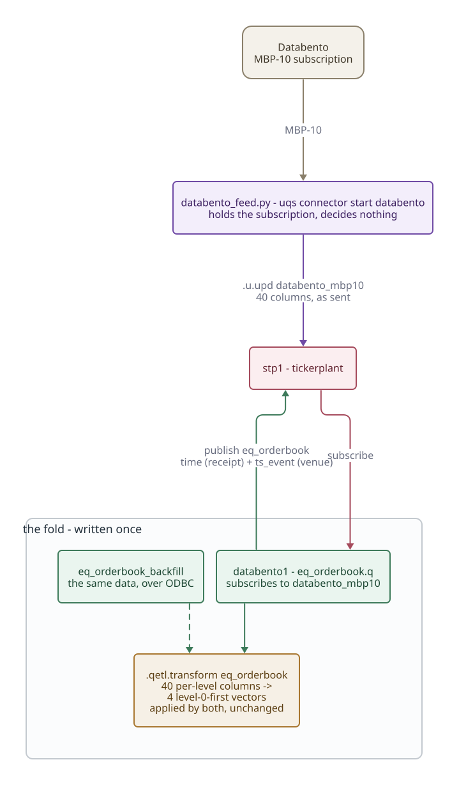

# Databento market depth

A live market-data feed: an external Python handler publishes raw MBP-10 rows,
and `databento1` folds them into the book shape. Starting, stopping and
inspecting the stack as a whole is in [running the uqf stack](../guides/uqs.md).



**Install the bundle first.** Everything on this page - `databento_mbp10`,
`databento1`, `eq_orderbook`, the ODBC source, the backfill
`databento_backfill1`, and the Python handler itself (`databento_feed.py` and
the `databento_streamer.py` it runs) - is the `sidecars/databento` bundle, kept
out of the tree because it is tied to one outside system:

```
uqs job install sidecars/databento --dry-run
uqs job install sidecars/databento --yes
```

The handler is installed with the q half, from the same snapshot, into
`src/etl/connectors/databento/`, and runs from there - never from the bundle's
folder, so the streamer and the table it writes columns into by position are
always one version. Until the bundle is installed there is no `databento`
connector: `uqs connector start databento` reports an unknown connector, and
`--databento-dataset` and `--api-key` are unknown options. Editing the bundle's
`databento_feed.py` changes nothing until it is installed again.

`uqs connector start databento`/`stop`/`status` subscribe to
[Databento](https://databento.com) and stream MBP-10 into this stack. It is the
live counterpart to the ODBC backfill in
[`new-pipeline.md`](../guides/new-pipeline.md): same vendor, same schema, same
fold - the difference is only whether the rows arrive from a historical query or
a subscription.

```
uqs connector start databento                                  # XNAS.ITCH, AAPL/MSFT
uqs connector start databento --databento-dataset XNAS.ITCH --symbols AAPL,TSLA
uqs connector status databento
uqs connector stop databento
```

Needs `$DATABENTO_API_KEY` (Databento's own variable, so an existing export
works). It refuses to start without one rather than failing on its first call.

**Two halves, and the split is the point.** A Python handler holds the
subscription and publishes raw MBP-10 onto `databento_mbp10` - forty per-level
columns, exactly as Databento sends them. `databento1`, an ordinary streaming
job, subscribes to that and republishes `eq_orderbook`, folding the forty
columns into four level-0-first vectors with **the same `.qetl.transform`
transform the backfill uses**. The fold exists once, in q, with its own worked
examples; the Python side decides nothing about what a book is.

The handler is not a process.csv row, for the same reason cryptorust is not: a q
process cannot hold a Databento subscription, so it gets a pidfile and a
subprocess rather than a `torq.sh` entry. `databento1` *is* a normal row, but
`startwithall=0`: with no handler running nothing publishes the table it
subscribes to, so it starts with the handler (`uqs start databento1`) or not at
all.

```
uqs query "select from eq_orderbook" --port 6052   # rdb1
uqs query "select time, ts_event, sym, price from eq_orderbook" --port 6052
```

Rows carry **both** clocks: `time` is stamped by the tickerplant on receipt,
`ts_event` is Databento's own. Their difference is the feed's latency - and a
feed whose venue clock is wrong is visible instead of silent, which a Binance
book stamped 1973 in the crypto recorder was not.
